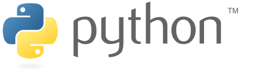

# Python User Group Graz

We are a group of people meeting on a regular basis in [Graz](https://osm.org/go/0Iz~DnN--?relation=34719) (Styria/Austria) to talk about the programming language [Python](https://www.python.org).

We are open for everyone and are looking forward to meeting you!

Usually we meet on the **first Tuesday of the month**. Topics and locations are announced here when available.

## Next meeting: Lightning talks

:material-clock-time-seven-outline: Tuesday, Decemer 1st 2026, 19:00 
:material-map-marker-outline: [Spektral](http://spektral.at/), Lendkai 45, 8020 Graz

[Lightning talks](https://en.wikipedia.org/wiki/Lightning_talks){:target="\_blank"} are very short presentations lasting only a few minutes. They are a great opportunity to share your knowledge with others and learn about multiple topics at once.

Did you find a helpful Python package? Did you encounter Python at a place you never expected? Did you see an interesting talk at a Python conference? Did you learn about a nifty tool that simplifies Python development? Did you automate a boring chore using Python?

Make a short presentation about it, typically 5 to 10 minutes, though it's perfectly fine to be quicker. If needed, use slides, show a related website - or just talk.

Of course, everyone is welcome to just watch and listen, even without giving a talk.

There is no need to propose a talk beforehand. Just drop by and we arrange the agenda together.

The event will be held in English unless everyone on-site speaks German. For slides, English is recommended so the information can be accessed afterward by a large audience.

## Last meeting

[Python code quality: tools and aspects](meetings/2026/2026-09-01.md)

## Stay connected

To keep informed about our events, you can follow us on [events.graz.social/@pygraz](https://events.graz.social/@pygraz).
